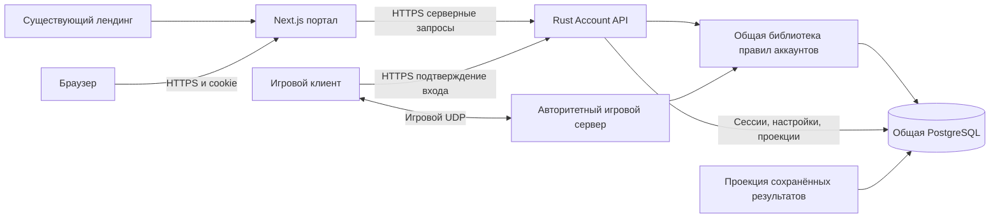

# ТЗ: Omoba Player Portal

Дата: 2026-09-15. Статус: готово к реализации; перечисленные новые возможности
ещё не реализованы. Документ описывает первый полезный релиз P0 и расширение P1.
Целевая папка Next.js: этот репозиторий.

## 1. Назначение и пользовательская ценность

Игрок открывает сайт после матча и понимает, как он сыграл, как меняется его
прогресс и с кем можно сыграть ещё. На телефоне это доступно без запуска тяжёлого
игрового клиента. Сайт также помогает новому человеку найти подходящую сборку.

Три главных сценария P0:

1. «Я закончил матч: хочу посмотреть результат, урон, K/D/A и изменение рейтинга».
2. «Хочу понять, как играю за разные классы и улучшаются ли мои результаты».
3. «Хочу найти знакомого игрока и добавить его в друзья с тем же результатом в игре».

У портала, лендинга и игры разные задачи. Лендинг рассказывает о проекте и ведёт
в кабинет/загрузки. Портал обслуживает аккаунт и статистику. Матч, управление,
магазин предметов и выбор героя перед боем остаются в клиенте. Вход на сайт не
нужен для каждого запуска игры. Портал не является браузерной версией самой MOBA.

Предлагается отдельный поддомен портала и ссылки с действующего лендинга; точный
домен определяется при размещении. Авторизационные cookie ограничены порталом,
не распространяются на весь домен лендинга.

## 2. Проверенная исходная реализация

Срез исходников: `e62b728` плюс незакоммиченные iPhone-доработки rc.9. Перед
разработкой исполнитель проверяет актуальный main. Источники перечислены в §15.

| Область | Уже существует | Что требуется для сайта |
| --- | --- | --- |
| Аккаунт | Случайный `profile_id` из 64 hex-символов; ключ Ed25519 в установленном клиенте | Подтверждённая привязка браузера и веб-сессии |
| Результаты | PostgreSQL, неизменяемый финальный результат, исторические ники/классы/аватары, статистика и изменение MMR | Авторизованный HTTP API и страницы |
| Профиль | XP, рейтинг, матчи, победы/поражения | Веб-представление и настройки публикации |
| Друзья | Заявки и действия, общий лимит связей, присутствие | Тот же граф друзей в веб-интерфейсе |
| Доступ к чужим данным | Собственный профиль и профиль контактов; история/детали только своих матчей | Отдельная политика публичных карточек, без открытия всей БД |
| Рейтинг | Начальный Elo/MMR и новичковая группа | Объяснимое отображение; без выдуманных лиг/сезонов |
| Косметика | Каталоги, локальная презентация, отдельная интеграция avatar passport | Общий серверный выбор косметики и проверка владения — P1 |
| Тренировка с ботами | Локальный результат, без постоянной карьеры | Честное объяснение, почему такого матча нет в аккаунте |
| API сайта | Отсутствует: карьерный worker находится внутри игрового процесса | Новая HTTP-служба Account API |

В БД нет полного журнала игровых событий, реплея, временного графика урона,
истории покупок предметов, заработанного золота и статистики каждого отдельного
скилла. Эти показатели нельзя дорисовать из итогового результата.

## 3. Состав P0: страницы и поведение

| Адрес | Содержимое и действие пользователя |
| --- | --- |
| `/` | У вошедшего: прогресс, последний матч, последние результаты, заявки друзей, переход к загрузке. У гостя: назначение кабинета, вход через игру, ссылка на загрузку |
| `/login` | Код привязки, оставшееся время, инструкция для игрового клиента, состояния ожидания/подтверждения/отказа/истечения |
| `/me` | Свой ник, полный ID для копирования, уровень/XP, MMR, число рейтинговых матчей, победы/поражения, статус новичка |
| `/me/matches` | История с датой, длительностью, классом/аватаром, исходом, K/D/A, уроном героям, изменением MMR и признаком рейтингового матча |
| `/matches/[resultId]` | Итог двух команд, исторические ники и выбранные персонажи, таблица участников, подтверждённые показатели и причина отсутствия рейтинговой награды |
| `/me/stats` | Фильтры периода и класса, доля побед, KDA, урон героям за минуту, добивания, результаты по классам и история изменения рейтинга |
| `/players` | Поиск по полному ID; поиск по нику только среди пользователей, включивших обнаружение |
| `/players/[profileId]` | Карточка с доступными этому зрителю полями; действие добавления в друзья; пояснение ограниченного доступа |
| `/friends` | Друзья, входящие/исходящие заявки, принять/отклонить/отменить/удалить, скопировать свой код, перейти в профиль |
| `/settings` | Язык, часовой пояс, ник, настройки публичной карточки и поиска, активные веб-сессии и выход |
| `/download` | Только реально доступные сборки: ОС/архитектура, версия, дата, размер, SHA-256, инструкция и статус тестирования |

Фильтры истории: период, класс, исход, `rated=all/true/false`. Состояние фильтров
хранится в URL и переживает обновление. История по умолчанию по 10 записей,
максимум 50 на запрос. Ники не уникальны: в результате поиска показывать
сокращённый различимый ID, а копировать всегда полный.

В детали матча показывать `completed`, `interrupted`, `abandoned` различимо.
«Прерван» не превращать в поражение. «Не рейтинговый» не превращать в «рейтинговый
с изменением 0». Подтверждённая победа с нулевой дельтой MMR — отдельный случай.
Исторические ник/косметика берутся из результата, а не из сегодняшнего профиля.

Друзья в браузере и игре — одна сущность. Присутствие из игры подписывать «В игре»,
«Онлайн в клиенте», «Не в сети» и время обновления. Браузер не продлевает игровое
присутствие и не делает пользователя играющим. При ошибке API — «Статус неизвестен».
Групповые приглашения в очередь и личный мессенджер не входят в P0.

Для статистики доступны 7/30/90 дней и всё время. Всегда показывать количество
матчей в выборке и дату актуальности. При менее 5 матчах — «Мало данных»; числовые
результаты остаются видны, убедительные выводы о силе класса не формулируются.

## 4. Архитектура и границы ответственности

**Next.js:** TypeScript, App Router, адаптивные страницы, серверное получение
данных, Route Handlers для браузерных запросов и cookie. Клиентские компоненты
нужны для интерактивных фильтров/графиков, а не для хранения игровых секретов.
Поддерживаемые версии Next/React/Node фиксируются lockfile при начале реализации.

**Account API:** отдельный Rust binary в игровом workspace. Его можно запускать
рядом с сервером и БД на одном хосте в бете. Он обслуживает аккаунты независимо
от наличия запущенного матча. Разделение — по процессам и полномочиям; Kubernetes,
Kafka, Redis и отдельная машина для каждой службы не требуются.

Из существующего Rust career-кода выделить только переиспользуемые правила и
операции аккаунта/друзей/чтения. Сервер и API используют их совместно. Не копировать
Elo, проверки ников, лимиты друзей и разрешения в TypeScript. Связать сессию с
`Actor(profile_id)` внутри API; не доверять присланному браузером `actorId`.

Игровой сервер остаётся единственным владельцем старта/завершения матча,
начисления XP/MMR и игровых результатов. Account API вправе менять только
разрешённые поля аккаунта/друзей и данные портала. Веб не может редактировать
урон, победителя, рейтинг, награды, roster или завершать матч.

Next.js не получает `DATABASE_URL` игровой БД и не выполняет SQL. В БД ходят
Account API, игровой worker и ограниченный worker проекции. Браузер никогда не
подключается к PostgreSQL. Это архитектурное решение проекта; возможности Next
как BFF и серверная проверка доступа описаны в официальной документации [1][2].

## 5. Вход в тот же игровой аккаунт

В P0 не создавать самостоятельную регистрацию с новым профилем. У нового игрока
есть загрузка клиента и объяснение: сначала создать игровой профиль на сервере
с постоянной карьерой, затем связать браузер. Веб-сессия не требует активной игры
после завершения привязки.

### Подтверждение через установленную игру

1. Браузер начинает привязку POST-запросом. Account API создаёт случайные
   `pair_id`, nonce и отдельный секрет ожидания не менее 256 бит. В БД сохраняются
   хеш секрета и срок. Секрет находится только в защищённой preauth-cookie/BFF,
   не попадает в QR, URL, localStorage, аналитику или логи.
2. Сайт показывает одноразовый код из 8 символов без похожих знаков, сгруппированный
   для ввода. Срок — 5 минут; опрос не чаще раза в 3 секунды. Новая попытка в том
   же браузере отменяет прежнюю. Код сам по себе не даёт получить сессию.
3. В клиенте добавить «Аккаунт → Войти на сайт»: ввод кода, получение типизированного
   challenge по HTTPS от разрешённого Account API. На том же телефоне можно
   переключиться из браузера в игру; deep link не является условием P0.
4. Игра показывает текущий ник/ID, точный официальный origin портала и действие
   «Разрешить этому браузеру доступ к аккаунту» и конкретные разрешения: просмотр
   статистики, управление друзьями, ником и веб-настройками. Требуется явное нажатие. Сообщить,
   что подтверждать следует только код со своего открытого браузера. Отказ отменяет
   запрос; чужой или произвольный QR-host не становится доверенным origin.
5. Клиент подписывает только структуру `WebPairDecisionV1` существующим Ed25519
   ключом. Поля: domain `omoba.web.pair.v1`, audience/origin, pair ID, nonce,
   public key, browser-binding digest, decision `approve`/`deny`, точный набор
   разрешений и expiry. Endpoint approve принимает только подписанный approve,
   deny — только подписанный deny; перестановка endpoint не меняет решение. Формат
   signing bytes задаётся в общей Rust-библиотеке и проверяется golden vectors.
   Не подписывать произвольные присланные байты и не переиспользовать UDP challenge,
   nonce или счётчик игровых действий.
6. API проверяет подпись, существующую запись `career_keys`, nonce, срок, origin,
   разрешения, состояние и browser binding. Владелец определяется по ключу из БД,
   не по нику/ID из тела запроса. Неизвестный ключ получает «Сначала создайте игровой
   аккаунт»; нельзя неявно создать или объединить профили.
7. Только исходный браузер с секретом ожидания обменивает подтверждение на opaque
   сессию. Атомарное погашение: один pair ID создаёт максимум одну сессию. Если
   ответ потерян, повтор с тем же секретом восстанавливает тот же результат в
   коротком окне; не выдаёт вторую независимую сессию. Для такого повтора потребуется
   отдельный зашифрованный delivery envelope с TTL 60 секунд, доступный только при
   том же browser binding; одного хеша session token для восстановления ответа
   недостаточно. После окна запрос требует новой привязки. Envelope не логируется
   и удаляется по TTL; постоянная session-таблица хранит только хеш. Чужой секрет
   не подходит. Использовать проверенную библиотеку шифрования, не свой алгоритм.

Состояния: `pending → approved → consumed`, а также `denied`, `expired`, `cancelled`.
Чужой/истёкший/повторный proof не продлевает срок. Ограничения: 5 стартов привязки
в минуту на IP с burst 5; не более 5 неверных вводов на попытку и 20 lookup на IP
в минуту; после превышения — 429/Retry-After. Это стартовые параметры беты,
подлежащие проверке на общем NAT; лимиты должны работать между экземплярами API.

HTTP в клиенте выполняется в ограниченном фоновом worker с timeout/cancellation,
не блокирует Bevy Update и запуск окна. В проекте уже используется reqwest/rustls;
исполнитель проверяет доступность прямой зависимости и переиспользование транспорта.
Приватный ключ остаётся в существующем хранилище. Не вводить метод «подпиши любые
байты», экспорт seed, вход по friend ID или присвоение wallet ID игровому профилю.

Поток заимствует принцип разделения устройства подтверждения и кода из device
authorization, но не объявляется реализацией OAuth RFC 8628 [3].

### Веб-сессии

Opaque token, хеш токена в PostgreSQL, HttpOnly/Secure/SameSite=Lax, host-only cookie.
Абсолютный срок 7 дней, неактивность 24 часа. Вход ротирует preauth/session, logout
отзывает сессию серверно и очищает cookie. Список сессий: дата входа, последнее
использование, понятное название браузера, текущая сессия; полный токен не показывать.
Отзыв других сессий требует подтверждения в игре не старше 10 минут. Точный scope
входа включает чтение своих данных, управление друзьями, ником и веб-настройками;
добавление игровых ключей и восстановление аккаунта не входят в него.

Подтверждение в игре необходимо повторить после истечения веб-сессии. Passkeys,
восстановление доступа и привязка нескольких игровых устройств — P1 с отдельными
сценариями отзыва/потери. Схема уже допускает несколько ключей к одному профилю,
но операция их привязки сейчас отсутствует. Наличие веб-сессии не должно позволять
незаметно добавить новый игровой ключ. Привязка двух уже существующих аккаунтов
и объединение их рейтингов не входят в план.

## 6. Данные, доступ и публичность

| Данные | Владелец | Друг/контакт | Посторонний/гость |
| --- | --- | --- | --- |
| Профиль и базовые сводные показатели | Да | Существующее право друзей и pending-контактов | Только явно опубликованные поля |
| История и персональная подробная аналитика | Да | Нет в P0 | Нет |
| Полная карточка матча со всеми участниками | Только участник этого матча | Только если тоже участвовал | Нет |
| Друзья, заявки, веб-сессии и настройки | Да | Нет | Нет |
| Игровое присутствие | Да | Принятые друзья | Нет |
| Ключи и технические токены | Не выводить | Не выводить | Не выводить |

Для поиска и публичных страниц добавить явные opt-in настройки:
`public_profile_enabled`, `public_stats_enabled`, `discoverable`. По умолчанию
все false, в том числе у существующих игроков. `discoverable` и публичная
статистика требуют включённой публичной карточки. Отключение карточки сбрасывает
зависимые настройки и немедленно исключает профиль из поиска.

Публичная карточка: ник, публичный ID, пользовательское описание при его будущей
поддержке; в P0 без произвольного HTML и без загрузки файлов. При включённой
публичной статистике — только согласованный базовый набор: уровень, MMR,
рейтинговые матчи, победы/поражения и доля побед с обозначением выборки. Не
публиковать автоматически чужую историю, список друзей и статусы присутствия.
Непубличный профиль постороннему возвращает нейтральный 404.

Существующая игра уже разрешает базовый профиль контактам с pending-заявкой.
Веб-переключатель публикации не обещает отменить это старое игровое право.
Сужение доступа контактов при необходимости делается одновременно в игре и API.
После удаления связи новая проверка доступа выполняется на каждом запросе.

Сейчас `CareerStore::friends` также включает presence входящих/исходящих заявок.
Account API обязан вырезать presence из DTO pending-контактов согласно этой
матрице. Старое поведение клиента от этого не меняется; если нужна одинаковая
более строгая политика, изменить игру и веб вместе, отдельно зафиксировав это.

Общие ссылки на полные матчевые таблицы и их индексация поисковиками отложены:
один участник не может публиковать данные всех остальных. Авторизованные страницы
и ответы имеют `private, no-store`, не попадают в общий CDN/RSC-кеш. В P0 даже
публичные профильные JSON-ответы не кешировать общим кешем, чтобы отзыв публикации
вступал в силу сразу. Статические ресурсы и каталог сборок можно кешировать.
Открытая карточка перечитывает права при возврате фокуса и не реже раза в 30 секунд;
уже показанные пользователю данные невозможно «забрать обратно».

## 7. Реальная схема PostgreSQL и правила миграций

| Таблица | Использование |
| --- | --- |
| `career_profiles` | ID, ник, rating, rated_matches, matches_played, wins, losses, progression_xp |
| `career_keys` | public_key → profile_id; проверка подписи только в серверной части |
| `career_matches` | allocation/checkpoint/intent/result JSONB; status, seq, settled_at |
| `career_participants` | Связь профиля с матчем, seat, player_id; не содержит колонок K/D/A |
| `career_friendships` | Каноническая пара low_id/high_id, requested_by, accepted |
| `career_presence` | Ограниченный срок игрового присутствия |
| `career_active_profiles` | Резервирование аккаунта активным матчем; сайту не изменять |

Показатели участника читать из `career_matches.result.participants[].stats` после
`status='settled'`. Для связки нужен настоящий `result_id`, не локальный `match_id`
или `server_epoch`: разные серверы могут иметь одинаковые локальные номера.
Не показывать checkpoint/intents как сохранённые завершённые матчи.

Текущий `CareerStore::connect` принимает **только** `career_schema_version=[1]`.
Автоматический Prisma/Drizzle `db push`, пересоздание career-таблиц или повышение
этой версии на 2 без обновления игрового сервера сломает совместимость.

Новые таблицы P0 создаются в отдельной схеме `portal` с собственной историей
миграций и явными квалифицированными SQL-именами:

- `web_pairings`: хеши/nonce/срок/browser binding/статус/подтверждённый profile ID.
- `web_sessions`: profile ID, hash token, scope, expiry/idle/revoked, метаданные сессии.
- `operation_receipts`: session/actor/action/idempotency key, hash тела, результат
  и срок; хранить не менее срока возможной валидности соответствующей сессии.
- `profile_settings`: profile ID FK, privacy, locale, timezone, версия настроек.
- `player_match_facts`: производные факты по `(result_id, player_id)` и версии
  проекции; отдельный индекс `(profile_id, ended_at, result_id)` и для фильтра класса.
- `projected_results`: result ID, версия/хеш исходного результата, статус проекции.
- `audit_events`: события входа/отзыва/изменений; без приватных ключей, code/token и
  сырого текста чата. Срок хранения диагностических записей — 30 дней для беты.

Игровые ключи и профили не копировать в новую независимую систему users. Внешние
ключи связывают portal с существующими career-профилями. При отдельной тестовой
схеме career её имя конфигурируется и валидируется, а не берётся из браузера.

Один мигратор применяет версионные изменения транзакционно под advisory lock;
runtime-процессы проверяют совместимость и не требуют DDL-прав. Разделение
`CareerStore` на migrate/connect-runtime должно сохранить имеющиеся игровые
проверки и быть покрыто интеграционным тестом старой схемы. Для P0 career version
остаётся 1. Изменение core-схемы позже требует отдельного плана совместимости.

Роли БД разделить: игровой worker — игровые операции; Account API — чтение
необходимых полей, разрешённые изменения ника/друзей и таблицы portal; projector —
чтение settled и запись производных фактов. У веб-роли нет UPDATE/DELETE матчей,
XP или rating. Политика пользователя проверяется API дополнительно к SQL GRANT.
Соединения ограничены пулами; лимиты суммируются для всех процессов.

## 8. Статистика: определения, свежесть и ограничения

| Показатель | Правило |
| --- | --- |
| Доля побед | wins / (wins + losses) × 100 только завершённых выбранных матчей; при знаменателе 0 — «Нет завершённых матчей» |
| K/D/A | Три отдельных фактических числа; агрегированный KDA = Σ(kills + assists) / max(1, Σdeaths), формула доступна в подсказке |
| Урон героям за минуту | Σdamage_to_heroes / (Σduration_ms / 60000), только положительные длительности; это среднее по длительности матча, не по времени в живых |
| Добивания | minion_last_hits и jungle_last_hits раздельно; при объединении явно подписать сумму |
| Изменение рейтинга | Только сохранённый ParticipantResult.rating; null означает отсутствие рейтингового изменения |
| Уровень профиля | 1 + floor(progression_xp / 1000); не путать с final_level в отдельном матче |
| Результаты по классам | Группировать hero_class; avatar/sprite — косметические варианты, не отдельные уникальные наборы умений |
| Новичок | rated_matches < 20, как в текущих правилах; порог отдаётся API вместе с версией правил |

Аналитика по умолчанию — завершённые рейтинговые матчи. Пользователь может
включить сохранённые нерейтинговые; подписывать изменение выборки. Общие
`wins/losses` профиля включают завершённые нерейтинговые матчи: их нельзя выдавать
за рейтинг-статистику. Счётчик `matches_played` может включать прерванные матчи.
Пустая история при большом числе тренировок — допустимое состояние.

Фильтр периода применяется к ended_at в интервале [from, to) UTC. UI переводит
локальные календарные границы с учётом выбранного часового пояса. Все показатели
на одной странице используют одинаковые фильтры и snapshot/version проекции.
Рейтинговый график строится по сохранённым before/after/delta, без вымышленных
начальных точек, сезонов или восстановления пропущенных данных. Текущий MMR
берётся из профиля даже при задержке графика.

Для сортировки больших историй — keyset pagination с детерминированным tie-breaker.
Существующий cursor по `seq` отражает выдачу номера allocation, а не порядок
завершения; не смешивать семантику старого UDP cursor и нового HTTP cursor.
HTTP cursor непрозрачный, версионный, связан с фильтрами и прошедший проверку.
Обновление первой страницы находит поздно сохранённый матч; стабильный архивный
snapshot всех страниц в P0 не обещается.

Проектор читает только неизменяемые settled-результаты ограниченными пакетами,
формирует факты и marker одной транзакцией. Повтор запуска не удваивает статистику.
Выборка ищет settled-результаты без актуального marker по result ID/версии, а не
только `seq > last_seq`: старый allocation может завершиться позже нового.
Уникальные ключи, блокировка работы и upsert обеспечивают идемпотентность при
нескольких workers. Backfill проверяется на позднем settlement и повторном запуске.

История/детали доступны прямо из settled-источника; графики — из read model.
Цель P0: результат в истории не позднее 10 секунд после commit при исправном
сервисе, аналитика — не позднее 60 секунд. API сообщает `data_as_of`,
`projection_status`, `pending_results`. При отставании показывать «Статистика
обновляется», а не нули. При недоступной БД/API — явная ошибка с повтором,
никаких демонстрационных данных вместо настоящего аккаунта.

Не выводить «ты хуже 80% игроков», «идеальный билд», «MVP матча» или причинный
совет о победе без отдельно заданной методики и достаточных данных. P0 предоставляет
сравнения собственных показателей и понятные исходные числа.

## 9. HTTP-контракт P0

Версия `/v1`. OpenAPI — часть сдачи; TypeScript client генерируется/проверяется по
контракту, DTO явно отделены от внутренних Rust/SQL структур. Browser BFF использует
`/api/...`; Server Components могут обращаться напрямую к Account API серверным
клиентом. Нельзя дать браузеру произвольный proxy URL или доверенный service token.

| Метод и путь Account API | Назначение |
| --- | --- |
| `POST /v1/auth/pairings` | Создать preauth-запрос; код/expiry и защищённая привязка браузера |
| `POST /v1/auth/pairings/lookup` | Игровой клиент вводит код; получить только безопасный типизированный challenge |
| `POST /v1/auth/pairings/approve` | Native typed proof; подпись существующего ключа обязательна |
| `POST /v1/auth/pairings/deny` | Подписанный отказ из клиента |
| `POST /v1/auth/pairings/status` | Опрос с секретом исходного браузера; без секретов в URL |
| `POST /v1/auth/pairings/complete` | Погасить одобрение и получить одну веб-сессию |
| `DELETE /v1/auth/pairings/current` | Отмена браузером с правильным preauth binding |
| `GET /v1/me` | Свой профиль, права, настройки и версия правил |
| `GET /v1/me/matches` | Пагинированная история и фильтры |
| `GET /v1/matches/{resultId}` | Полная карточка только реальному участнику |
| `GET /v1/me/statistics` | Агрегаты, классы и точки MMR для заданных фильтров |
| `GET /v1/players?query=...` | Вошедший пользователь: exact ID или opt-in поиск по нику; максимум 20 записей |
| `GET /v1/players/{profileId}` | DTO по текущим правам/публикации |
| `GET /v1/me/friends` | Списки и актуальность присутствия |
| `POST /v1/me/friend-actions` | target_profile_id и request/accept/reject/cancel/remove |
| `PATCH /v1/me/profile` | Только nickname по существующему Rust-валидатору |
| `PATCH /v1/me/settings` | Разрешённые поля privacy/locale/timezone, optimistic version |
| `GET /v1/me/sessions` | Список собственных веб-сессий без токенов |
| `DELETE /v1/me/sessions/{id}` | Отзыв с проверкой владельца и свежести подтверждения |
| `POST /v1/auth/logout` | Отзыв текущей сессии |
| `GET /v1/releases` | Курируемый каталог реально опубликованных сборок |
| `GET /health/live`, `GET /health/ready` | Живость процесса и готовность зависимостей; без внутренних адресов/секретов |

Для мутаций: строгая схема запроса, неизвестные поля отклоняются; `Idempotency-Key`
связан с session/actor/action/body. Receipt сохраняется 8 дней при максимальном
сроке сессии 7 дней; истёкшая/отозванная сессия не может переисполнить старый запрос.
Один ключ с другим телом — 409. При смене сессии UI удаляет очередь старых мутаций.
Особенно проверить, что повтор старого remove не удаляет новую friendship:
повтор возвращает исходный результат, а не исполняет старое действие заново.
Accept/reject/cancel/remove дополнительно несут выданный сервером opaque ETag
ожидаемой связи. Он учитывает конкретное создание и состояние связи (включая
точный created_at), а не только пару ID. Проверка выполняется под той же
транзакционной блокировкой, что изменение; устаревшее состояние даёт 409 и refresh.
Это также предотвращает первое позднее выполнение запроса к уже заменённой связи.
Ошибки: 400 validation, 401 session, 404 отсутствует/недоступно, 409 conflict,
429 limit, 503 dependency; JSON содержит стабильный code и request_id без SQL/stack.

Все u64/BIGINT/идентификаторы, которые могут выйти за 2^53, передаются decimal
string либо opaque string: player_id, match_id, server_epoch, seq, XP, cursor.
Время — RFC3339 UTC; ограниченные счётчики/рейтинг могут быть JSON number. Урон —
конечное неотрицательное число; отсутствующее поле/null не заменяется нулём.
Не проксировать raw Rust UDP JSON через JavaScript Number для подписей.

Перед каждым чтением и изменением выполняется серверная авторизация, включая
прямой вызов Route Handler/Server Action. Скрытая кнопка, layout или middleware
не являются единственным контролем доступа [1].

## 10. Косметика и расширения P1

Страница `/collection` появляется после отдельной реализации серверного выбора.
На первом этапе — быстрые 2D-превью аватаров, снарядов, эффектов и реакций;
3D-preview загружается по желанию и не блокирует мобильную страницу.

Необходимые условия редактирования:

1. Версионный публичный каталог со стабильными ID, типом, совместимостью и
   лицензией; PNG/GLB из проверенного хранилища, без произвольных внешних URL.
2. Account API хранит preferred cosmetic loadout по account/class с revision.
   Клиент забирает его при входе/выборе героя. Матч фиксирует выбранный snapshot;
   изменение на сайте не меняет уже начавшийся бой.
3. Сервер повторно проверяет права на косметику при выборе. Браузер не присылает
   `owned=true`, модель, сетевой путь или игровые статы. При потере владения —
   безопасный бесплатный вариант и объяснение, без изменения класса/баланса.
4. Конкурентные изменения сайта и клиента используют expected_revision; конфликт
   даёт перечитать выбор, а не молча перетирать его. Источник истины общий.
5. NFT/платные варианты доступны только при доверенном подтверждении владения.
   Avatar passport — отдельная нынешняя интеграция; считать её готовым единым
   аккаунтом сайта или универсальным NFT-провайдером нельзя. Реакции с NFT сейчас
   требуют ещё не реализованного ownership provider. Wallet login сам по себе
   не доказывает владение игровым профилем.

Без этих условий допустим только честно подписанный каталог, без кнопки
«Применено в игре». Тест P1: изменить бесплатный образ на сайте, войти в клиент,
получить тот же revision, сыграть и увидеть выбранный образ в историческом результате.

Другие P1: passkey вход после связи с игровым аккаунтом; восстановление и новые
игровые устройства с отдельным подтверждением; рейтинг публично согласившихся
игроков с группой новичков и порогом матчей; дополнительные способы кооперации.
Браузерный запуск боя, replay/spectator, голос, маркетплейс/NFT-mint, платежи,
глобальный matchmaking и мобильный лаунчер не входят в это ТЗ P0.

## 11. Интерфейс и доступность

Приоритет — телефон в портретной ориентации; второй основной сценарий — десктоп.
Навигация на телефоне: Обзор / Матчи / Игроки / Друзья / Профиль. На десктопе —
боковая навигация и больше пространства для сравнений. Общий визуальный язык с
игрой/лендингом: собственные цвета и ассеты Omoba; оформление Wild Rift не копировать.

Таблица матча на узком экране превращается в карточки с раскрытием деталей.
Ник, исход и основные показатели читаются без горизонтальной прокрутки. Урон
разделяется на героев, строения и существ. Графики имеют подписи осей/единиц,
табличную альтернативу, различаются не только цветом. Исход подписывается текстом.

Поддержать клавиатуру, видимый focus, screen reader labels, reduced motion,
минимальные зоны нажатия 44 CSS px. Состояния loading/empty/private/error/offline
обязательны для каждого экрана. Изменение фильтра не стирает старые данные до
ответа, но явно показывает обновление. Ошибка действия друзей не выглядит успехом.

Словари RU/EN вынести из компонентов. Никнеймы Unicode проходят тот же игровой
валидатор (1–20 символов, ограничения байтов/допустимых знаков), не «исправляются»
в отдельные уникальные login names. Тестовые размеры: 360×800, 390×844, 844×390,
768×1024, 1440×900. Проверить Safari iOS и Chrome Android на реальных телефонах,
а также Safari/Chrome desktop. Эмуляция размера не заменяет физическую проверку.

## 12. Безопасность, эксплуатация и производительность P0

Все внешние запросы HTTPS. Мутации из браузера защищены проверкой Origin и CSRF,
включая вход/выход и Server Actions. Cookie сессии не читаются JS. Установка
публичного profile_id в запросе не меняет actor. Ограничить body, timeout, частоту
запросов и число параллельных тяжёлых статистических запросов на аккаунт.

Per-IP ограничения требуют доверенного ingress-контракта: reverse proxy удаляет
входящие forwarding-заголовки, определяет клиентский адрес только по проверенной
цепочке proxies и передаёт его Next.js. Next передаёт нормализованный адрес в
Account API через аутентифицированный внутренний канал (например, mTLS). API
принимает такой контекст только от доверенного BFF; native-клиенты не могут
выдавать себя за BFF и получают лимит по адресу своего доверенного ingress.
Нельзя доверять произвольному X-Forwarded-For или считать адрес Next адресом всех
игроков. До настройки такого канала per-IP лимит браузерного входа исполняется
на доверенном edge перед Next, а API дополняет его лимитами pair/account; отсутствие
проверенного способа определить адрес фиксируется как незавершённая конфигурация.
Начальные бюджеты: 120 обычных чтений/минуту, 20 действий/минуту и 10 аналитических
запросов/минуту на аккаунт; поиск 30/минуту. Ответ 429 содержит Retry-After.

Account API использует ограниченный DTO и не возвращает allocation, owner_id,
ключи, nonce, lease, внутренние URL или строки соединения. Проверить stored XSS
в никах, доступ к чужому result ID, session fixation, CSRF, replay и кеш-утечки
между двумя аккаунтами. Сервисные секреты не имеют префикса NEXT_PUBLIC.

Один начальный регион/обычная PostgreSQL достаточны для первого запуска по
результатам измерений. Проектор не работает внутри игрового тика. HTTP API не
мешает игре продолжать матч при недоступности портала. Карьерная БД сохраняет
свои прежние правила отказа и settlement; сайт не ослабляет их ради доступности.

Цели измерений, а не обещанная текущая ёмкость: на документированном стенде с
100 000 settled-матчей и до 1 млн фактов участников, при 50 одновременных
сессиях/20 запросах в секунду за 15 минут: p95 профиль/история <500 мс,
аналитика <1 с, ошибки <1%. Отдельно описать холодный кеш, железо, распределение
запросов, время SQL и нагрузку на игровой сервер. Проверить планы запросов и
индексы; не выполнять полный разбор JSON всех матчей при каждом открытии страницы.

Логи структурированные с request_id. Измерять ошибки, задержки, пул соединений,
очередь/отставание проекции, провалы привязки. Для размещения предоставить
конфигурацию процессов, healthchecks, инструкции миграции/отката приложения,
резервного копирования и восстановления тестовой БД. Не включать destructive
down migrations для результатов. Production-деплой и изменение секретов
выполняются отдельным согласованным действием после проверки.

## 13. Критерии приёмки P0

- AC01: из чистого checkout запускаются Next.js и API с документированными
  версиями; подключение к отдельной тестовой PostgreSQL, никаких личных секретов.
- AC02: существующий игрок связывает браузер через клиент; ID/рейтинг/друзья
  совпадают, второй аккаунт не появляется. Чужой ключ, неверный audience,
  истёкший/replayed proof, перестановка approve/deny и другой poll-secret не дают
  сессию. Spoofed forwarding-заголовок не меняет rate-limit identity.
- AC03: настоящий авторизованный матч проходит через существующий settlement;
  история и детали на сайте совпадают с сохранённым результатом по каждому
  показателю. Повтор сохранения и перезапуск не удваивают XP/MMR или статистику.
- AC04: проверены win/loss/zero deaths, рейтинг без дельты, unrated/interrupted,
  два одинаковых локальных match_id разных серверов, Unicode, u64 >2^53,
  старый allocation, завершившийся после нового, и пустая история практики.
- AC05: изменения друзей и ника видны в игре после refresh/reconnect, а изменения
  в игре видны в вебе; исторический ник не меняется. Повтор старого действия
  не изменяет новый граф отношений. Общий лимит 64 отношений сохранён.
- AC06: пользователь A не получает историю, сессии, друзей и закрытый профиль B
  прямым API/RSC/Action вызовом. Публичность только opt-in, отзыв работает после
  отключения, публичная страница не открывает полный матч с чужими данными.
- AC07: сервер игры, работающий с career version 1, совместим с portal-миграциями;
  неизвестная core-версия не игнорируется. Веб-роль не может обновить XP/MMR/results.
- AC08: штатный API outage отображается как ошибка/задержка. Нет фиктивных данных,
  успешных действий без подтверждения, сброса рейтинга или вмешательства в матч.
- AC09: desktop и реальные iOS/Android браузеры проходят вход/таблицу/фильтры/
  действия друзей; приложены снимки и результаты проверки клавиатуры/контраста.
- AC10: нагрузочный прогон §12 и проверка свежести §8 выполнены; приложены реальные
  метрики, условия и все отклонения. Скриншот или unit-тест не заменяет этот прогон.
- AC11: ссылки загрузки ведут на проверенные опубликованные артефакты. Сборка для
  личного iPhone с development provisioning не становится публичной iOS-раздачей.
- AC12: logout/revoke прекращают доступ, сессия одного аккаунта не кешируется для
  другого; секреты отсутствуют в HTML/RSC payload, URL, аналитике и логах.

Сдача: исходники, OpenAPI/типизированный клиент, миграции, тесты/фикстуры,
инструкции локального запуска и размещения, скриншоты PC/phone, протокол приёмки
PASS/FAIL/NOT_RUN с указанием версии игры/сайта/API. Нереализованные P1 функции
не скрывать за активными кнопками. Демо-данные допускаются только в явно отдельном
режиме разработки и не считаются доказательством интеграции.

## 14. Последовательность и показатель пользы

Сначала один сквозной сценарий: войти существующим игровым аккаунтом, сыграть,
увидеть на сайте настоящий результат. Затем история/анализ, друзья/публикация,
полировка и проверка эксплуатации. Коллекция и сложная авторизация P1 не должны
задерживать этот первый результат. Подробные задачи — [в backlog](IMPLEMENTATION_BACKLOG.md).

Проверяемая продуктовая гипотеза: кабинет помогает игрокам возвращаться к своим
матчам и находить знакомых. Считать успешные привязки, просмотры своего результата
после settlement, повторные посещения за 7 дней и принятые заявки друзей. Собирать
минимальные first-party события без содержимого матчей/ников/секретов. Факт
просмотра страницы не выдаётся за доказательство роста удержания: сравнивать
поведение нескольких тестовых когорт, показывая размер выборки.

## 15. Источники и точки входа исполнителю

Источники проверенного среза (факты о текущей игре), пути от корня репозитория игры
`omoba-bevy`:

- `shared/src/career.rs` — структуры,
  подписи, ограничения ников и ID.
- `server/src/career_store.rs` — операции
  PostgreSQL, миграция версии 1, доступ к профилям/истории/матчам.
- `server/migrations/postgres/001_career.sql`
  и `README.md` в этой папке — реальная схема, транзакции и границы.
- `docs/match-progression.md` — карьера,
  идентичность, eligibility и ограничения масштаба.
- `docs/bot-practice-and-social.md` —
  практика, друзья/чат и ограничения NFT-реакций.
- `docs/combat-cosmetics.md` и
  `docs/map-customization.md` — презентация и серверные правила.
- `apps/omoba/BETA-ACCESS.md` в репозитории лендинга — текущая
  доступность сборок и правила лендинга.

Внешние первичные источники проверены 2026-09-15. Они описывают инструменты и
паттерны; конкретная архитектура, сроки и ограничения выше — решения этого ТЗ.

[1]: https://nextjs.org/docs/app/guides/authentication
[2]: https://nextjs.org/docs/app/guides/backend-for-frontend
[3]: https://www.rfc-editor.org/rfc/rfc8628

- [Next.js: Authentication][1] — авторизация в серверном слое и доступ к данным.
- [Next.js: Backend for Frontend][2] — серверная часть интерфейса и Route Handlers.
- [RFC 8628: Device Authorization Grant][3] — разделение устройств, срок кода,
  ограничение опроса и риски подтверждения чужого входа.
