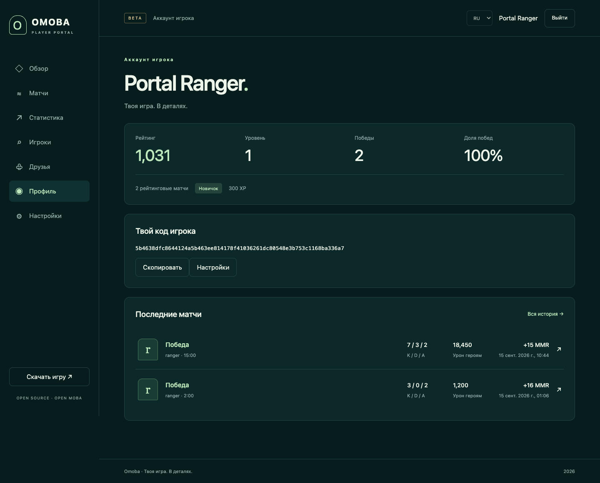
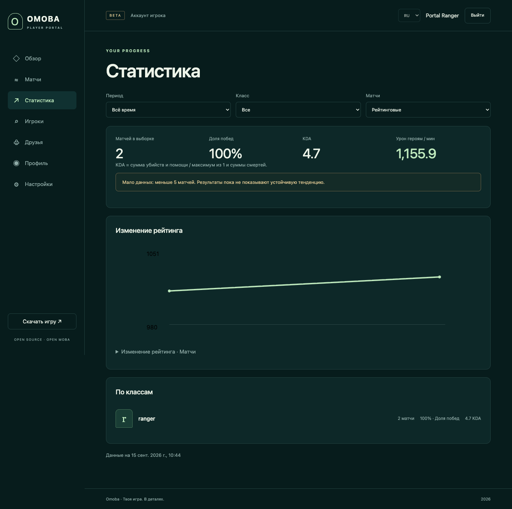
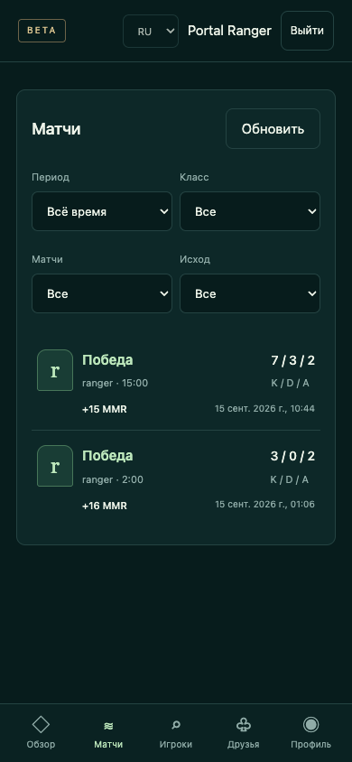

# Проверка Player Portal — 15 сентября 2026

Реализован локальный пилот на реальной PostgreSQL. Полная публичная приёмка P0
ещё не завершена: нет проверки физических телефонов, единого ручного сценария
в игровом клиенте и опубликованного каталога сборок. Production не менялся.

## Где находится результат

- Web 0.1.0: отдельный репозиторий `omoba-web`, Next.js 16.3.5 / React 19.3.0.
- Game / Account API 0.20.0-rc.1: соседняя папка `omoba-bevy-player-portal`,
  ветка `feature/player-portal-2026-09-15`, основа main `e62b728` (0.19.0-rc.8).
- Существующий main игры и незавершённая упаковка iPhone не изменены.
- Лендинг: `landing-v2/apps/omoba`; применены только три файла из согласованного
  [патча](integration/landing-player-portal.patch). Ссылка появляется после задания
  публичного HTTPS `OMOBA_PLAYER_PORTAL_URL`. Адрес не выдуман и не опубликован.
- Работа пока без коммита и push. Веб-репозиторий инициализирован локально, remote не задан.

## Что реализовано

Вход существующего игрового аккаунта через код и подпись в клиенте; ограниченные
браузерные сессии и отзыв; обзор профиля; история с фильтрами и курсором; закрытый
отчёт матча; статистика классов и рейтинга; друзья и заявки; смена ника; настройки
публичности, языка и часового пояса; поиск согласившихся игроков; каталог сборок.
Все продуктовые страницы используют API. Фикстуры применяются только отдельными
тестовыми командами. Скины/NFT, passkeys и публичный рейтинг остаются P1.

Account API переиспользует career-операции игры. Миграции запускаются явно ролью
владельца; runtime не выполняет DDL. Веб-роль не может изменять результаты, XP и
рейтинг. Схема career сохраняет version 1, portal имеет отдельную version 1.
Матчи проецируются фоновым обработчиком; позднее завершение старого матча не теряется.

## Выполненные проверки

- Frontend: 3 unit-теста BFF, TypeScript и production build — PASS.
- Rust: 31 тест клиента career, 55 shared, 8 passport, 2 API unit — PASS.
- PostgreSQL: 4 интеграционных сценария — PASS. Проверены реальные миграции,
  подтверждение/отмена/отказ/истечение pairing, повтор и конкурентное завершение
  входа, browser binding, idle expiry, отзыв и лимит 20 сессий, роли БД, приватность,
  друзья, устаревшее действие после нового отношения, Unicode и u64, settlement,
  поздняя проекция, unrated/interrupted, пустая аналитика и блокировка её конкуренции.
- Серверный UDP-тест — PASS: два подписанных профиля, очередь, сохранённый allocation,
  реальный cast/урон, победа, durable settlement, история и обновлённый рейтинг.
  Это ускоренный siege-сценарий с подготовленными позициями и HP базы, не полный
  матч, сыгранный человеком. Боевая и settlement-логика выполнялась реально.
- Chrome с production BFF, API и PostgreSQL — PASS: вход той же тестовой личности,
  HttpOnly, CSRF, no-store, страницы, отдельный гостевой браузер, выход/отзыв cookie.
  Подпись создавал отдельный Node signer с публичной синтетической фикстурой;
  приватный игровой ключ не передавался браузеру.
- Два авторизованных Chrome context — PASS: разные аккаунты не смешиваются,
  opt-in/отзыв публикации работает сразу, скрытая статистика не выдаётся,
  подмена actor отклоняется. Проверены ширины 360/393/430/768/1440, клавиатурный
  фокус и контраст основных текстов ≥4.5:1. Это не полный accessibility audit.
- API outage — PASS: процесс API остановлен, BFF возвращает 503, UI показывает
  ошибку и не создаёт фиктивный код. После запуска API доступ восстановлен.
- HTTP rate-limit — PASS: шесть запросов входа с разными поддельными forwarding
  заголовками дают 200×5 и 429, обход лимита не происходит. Проверены Retry-After
  и совпадение request_id ответа и заголовка. Финальные логи проверены на отсутствие
  тестового секрета, DSN и bearer/session token.
- Database outage — PASS: реальная остановка тестовой PostgreSQL,
  авторизованный BFF отвечает 503 и UI показывает ошибку; после рестарта
  восстанавливаются та же сессия и профиль с неизменным рейтингом. Скрипт повторён
  автоматически с явным портом 55581. Фоновая проекция продолжает работу после
  восстановления соединений.
- Clippy API/server all-targets с `-D warnings` — PASS.
- Лендинг: 4 beta-access теста и production build — PASS.
- Backup/restore — PASS: `pg_dump -Fc` и `pg_restore` в новую тестовую БД,
  совпали 100 000 результатов, 1 000 000 фактов и контрольная сумма неизменяемых
  результатов; обе версии схем равны 1. Это проверка восстановления, не настройка
  регулярных production backup.

## Производительность и пределы измерения

Стенд: Apple M4 Pro, 14 logical CPU, 48 GiB RAM, macOS 26.6; PostgreSQL 18 на
loopback:55581, Node 25.6.1, production Next standalone, Rust dev optimized build.
БД, API, сайт, генератор и отдельный игровой сервер находятся на одном компьютере.
Измеряется HTTP через BFF. Это не оценка WAN-задержек или ёмкости дешёвого VPS.

Выборка v2: 100 000 синтетических settled-матчей, 1 млн фактов участников,
10 000 профилей, ровно 100 матчей у каждого. Генератор проверяет распределение
до запуска нагрузки. Прежняя ошибочная выборка сохранена отдельно в этой же
тестовой БД, поэтому общий объём больше: около 200 000 матчей / 2 млн фактов.

Нагрузка: 50 действующих сессий, 20 req/s, 15 минут, 18 000 запросов;
50% профиль / 30% история / 20% аналитика. Сессии чередуют типы запросов, чтобы
каждая соблюдала действующий лимит аналитики 10/min. Одновременных HTTP-запросов
может быть меньше 50: это тест 50 сессий при фиксированных 20 req/s, не 50 запросов
в каждой миллисекунде. Итог: **PASS**, 18 000 ответов 200, ошибок **0%**; p95 профиль **8.75 ms**,
история **15.17 ms**, аналитика **11.98 ms**, peak concurrency 6.
Полные цифры: [load-result.json](load-result.json).

Рабочий SQL использует профильные индексы; планы с ANALYZE/BUFFERS сохранены.
В исправленной выборке агрегат прочитал 100 фактов через `facts_profile_date`:
0.333 ms; это отдельный SQL sample, не HTTP p95. Свежий реальный settlement был
подхвачен работающим API за 4339 ms во время предыдущей нагрузки. Матчевый процесс
работал отдельно; полноценная многопользовательская сессия и измерение игрового
тика под нагрузкой в этом прогоне не выполнялись.

При совместном запуске выявлен и исправлен дефект отдельной сборки сервера:
без Bevy `std` scheduler использовал активное ожидание. Сэмпл процесса подтвердил
этот стек; после включения `std` загрузка снизилась примерно с 99% до 0.6% ядра.
Сборка и перезапуск игрового процесса выполнены во время нагрузки; API-пути при
этом не менялись. Это дополнительная нагрузка на стенд, а не чистый production benchmark.

Кеш ОС не сбрасывался: после подготовки данных он частично прогрет. SQL-планы
отдельно показывают cache hits/reads. Полный cold-cache/production hardware тест
ещё нужен перед обещанием ёмкости сервера.

Отклонения сохранены: первый workload ошибочно закреплял аналитические запросы за
десятью сессиями и получил 429; последующая проверка обнаружила ошибку корреляции
SQL-генератора v1, концентрировавшую матчи на десяти профилях. Эти результаты не
выдаются за итоговый benchmark. Исправлены workload и генератор, добавлены проверки
распределения; старые данные/логи не удалялись. В тестах проекции устранена гонка
с фоновым worker: ожидание привязано к конкретному result_id.

## Матрица приёмки из ТЗ

| Критерий | Статус | Основание / остающееся условие |
|---|---|---|
| AC01 | PASS (локально) | Lockfiles, миграция, запуск API/Next с отдельной PostgreSQL; публичный deploy отдельно |
| AC02 | NOT_RUN полностью | Подпись, binding и негативные случаи автоматизированы; ручное подтверждение в native UI ещё не проверено |
| AC03 | NOT_RUN полностью | Реальный UDP settlement и веб-чтение проверены отдельными тестами; единый ручной матч → браузер не выполнен |
| AC04 | PASS | PostgreSQL contract/adversarial tests, точные строковые u64, поздняя проекция |
| AC05 | PASS автоматически | Единые career-операции, двустороннее чтение БД, stale relationship guard; ручной UX refresh ещё нужен |
| AC06 | PASS автоматически | Прямые API ACL/opt-in тесты, два авторизованных context и гость |
| AC07 | PASS | Runtime schema checks и реальные ограниченные роли, запуск игрового процесса |
| AC08 | PASS локально | Реальная остановка API и PostgreSQL, UI ошибки и восстановление сессии/профиля |
| AC09 | NOT_RUN полностью | Chrome/эмуляция экранов и скриншоты есть; физических iOS/Android и Safari нет |
| AC10 | NOT_RUN полностью | Локальный benchmark и свежесть записаны; cold-cache и gameplay tick на целевом сервере не измерены |
| AC11 | NOT_RUN | Публичные артефакты и их проверенные URL/hash не предоставлены; каталог честно пуст |
| AC12 | PASS автоматически | Logout/revoke, HttpOnly, no-store, CSRF, browser isolation; секреты не логируются |

## Скриншоты

Изолированные синтетические игроки и тестовые матчи, не реальные пользователи.
Снимки из production-сборки Chrome. Телефонные размеры — эмуляция viewport.

## Перед публичной бетой

Проверить native pairing и матч → портал на реальных PC/iPhone/Android; выполнить
Safari/Chrome device acceptance; подготовить подписанные публичные сборки и заполнить
каталог; выбрать production HTTPS origin, настроить доверенный ingress/лимиты,
роли, секреты, backup/мониторинг и запустить проверку на целевом сервере. Эти действия
требуют реального окружения и не заменяются локальными скриншотами.

Тестовые API, Next, игровой сервер и PostgreSQL остановлены после проверки.
Изолированные данные/дамп сохранены в игнорируемой `.agent/`; в Git они не входят.
Для повторного запуска использовать README и TESTING.md.
